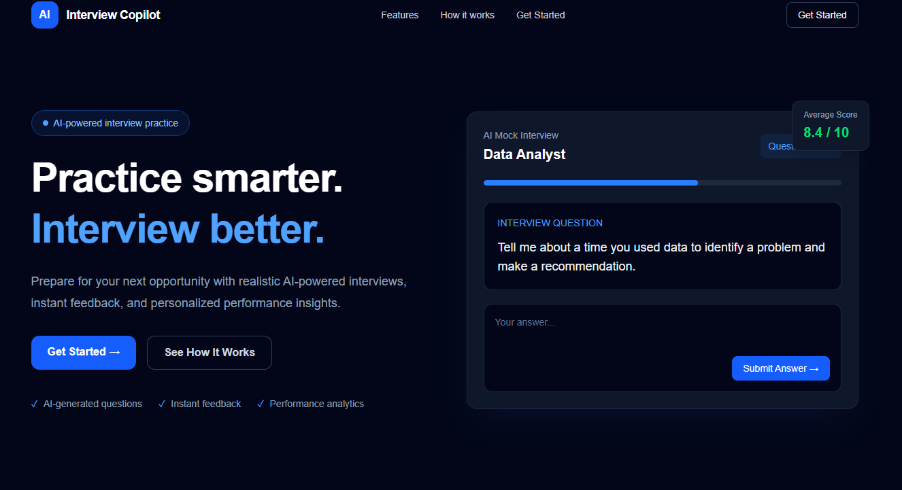
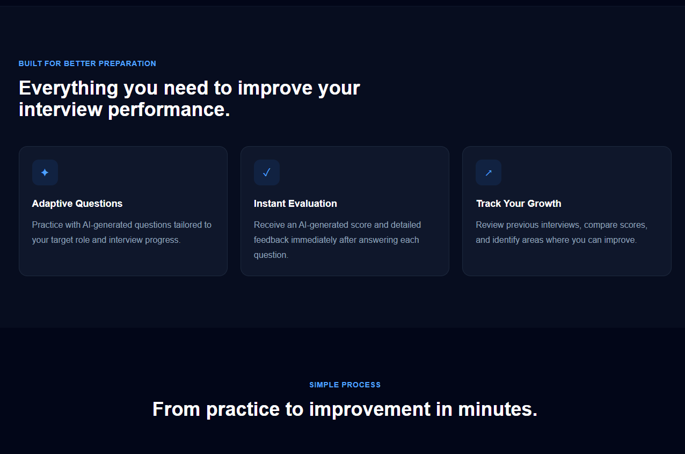
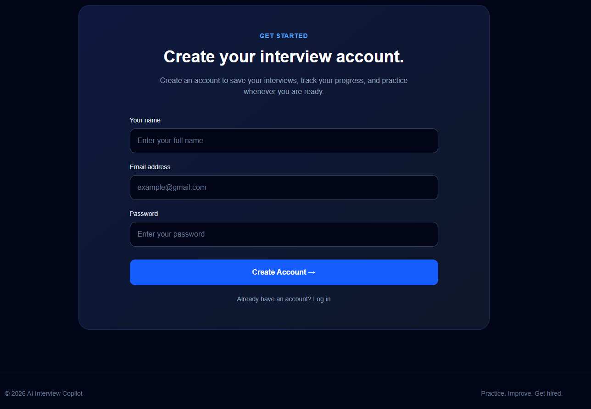
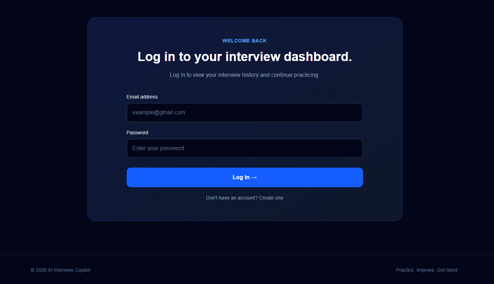
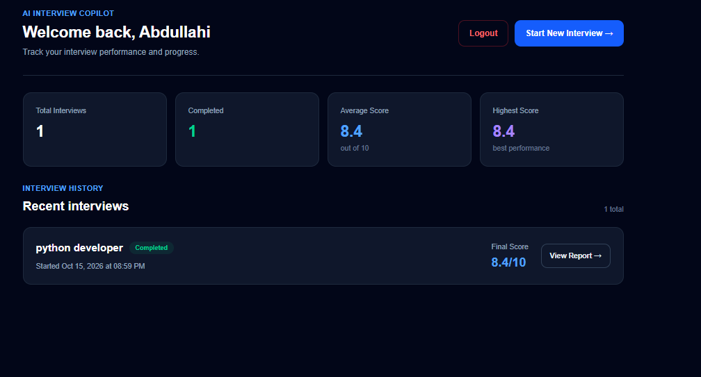
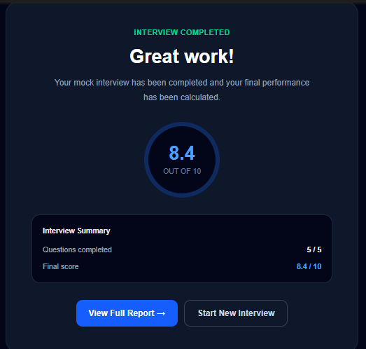
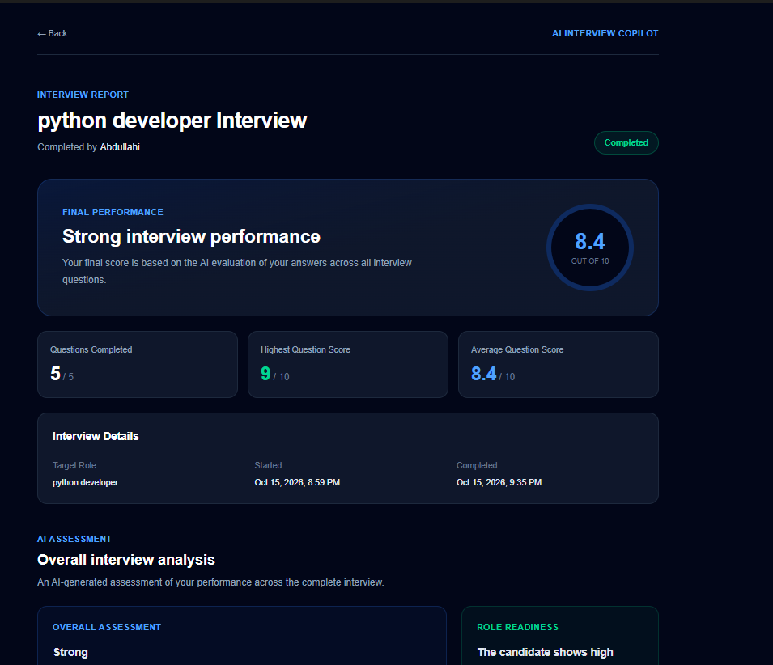
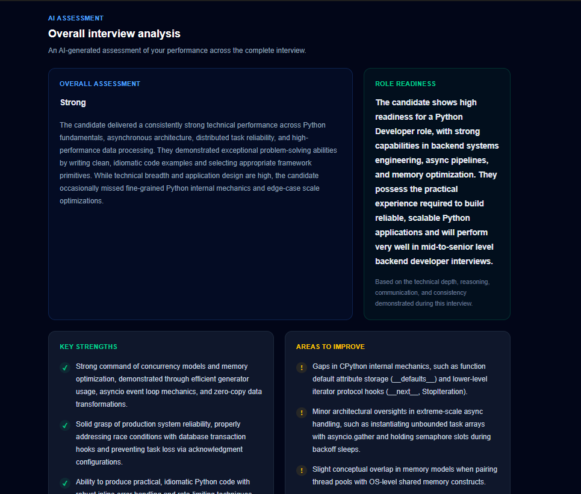
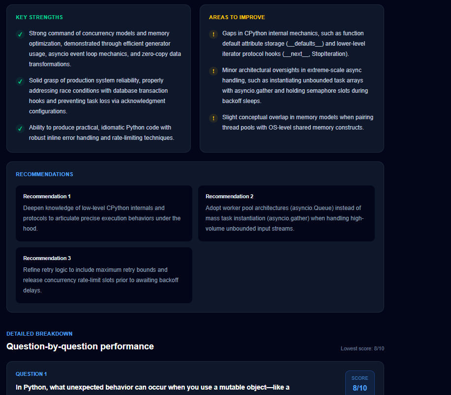
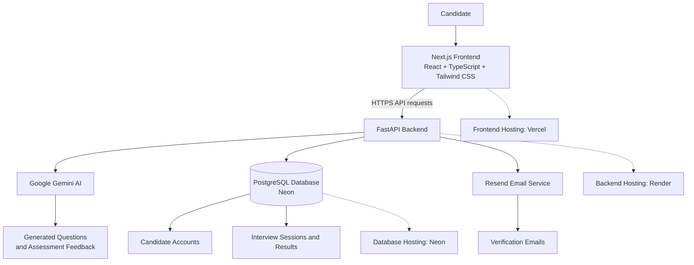

<div align="center">

# AI Interview Copilot

### Practise Smarter. Interview Better. Build Confidence.

An AI-powered interview preparation platform that helps candidates practise interviews, evaluate their answers, receive personalised feedback, and track their progress.

<br>

[**🚀 Try the Live Demo**](https://ai-interview-copilot-ten.vercel.app)

<br>


</div>

---

## Overview

AI Interview Copilot is an interview preparation application designed to help candidates improve their interview performance through structured practice and AI-assisted assessment.

Users can create an account, generate interview questions, submit their answers for evaluation, and review feedback through a personalised dashboard.

The platform combines a modern web interface, a Python backend, generative AI, and persistent database storage to provide an integrated interview practice experience.

**Try the application:** [ai-interview-copilot-ten.vercel.app](https://ai-interview-copilot-ten.vercel.app)

---

## Application Screenshots

### 1. Landing Page
Introduction to AI Interview Copilot and its main call to action.



### 2. Features and Workflow
An overview of the platform's interview preparation features and user workflow.



### 3. Account Registration
The registration interface for new candidates.



### 4. Login
The login interface for returning candidates.



### 5. Candidate Dashboard
Interview history, completed sessions, and performance statistics.



### 6. Interview Completion
The final score and confirmation displayed after completing an interview.



### 7. Assessment Report
The overall assessment, performance score, and role-readiness evaluation.



### 8. Strengths and Recommendations
AI-generated strengths, areas for improvement, and recommended next steps.



### 9. Detailed Performance Breakdown
Question-by-question scores and detailed assessment feedback.



---

## Key Features

- **Candidate Authentication:** Registration, email verification, login, and logout.
- **AI-Generated Questions:** Generate interview questions for practice.
- **Answer Evaluation:** Receive AI-generated scores and feedback on submitted answers.
- **Detailed Assessment Reports:** Review performance, strengths, and areas for improvement.
- **Interview History:** Revisit completed interviews and their reports.
- **Performance Dashboard:** Track completed interviews and assessment scores.
- **Persistent Storage:** Store candidate information and interview results in PostgreSQL.
- **Protected Dashboard:** Require authentication to access candidate dashboard functionality.

---

## Application Architecture



### Architecture Overview

**Frontend — Next.js**

Provides the user interface for account registration, interview practice, candidate dashboards, and assessment reports.

**Backend — FastAPI**

Handles API requests, application logic, authentication, interview workflows, and communication with external services.

**AI Integration — Google Gemini**

Supports interview question generation and AI-assisted answer assessment.

**Database — PostgreSQL**

Persists candidate account information and interview results.

**Email Service — Resend**

Supports email verification workflows.

**Deployment**

The frontend is hosted on Vercel, the backend on Render, and the PostgreSQL database on Neon.

---

## Technology Stack

| Component | Technology |
|---|---|
| Frontend Framework | Next.js |
| UI Library | React |
| Programming Languages | TypeScript, Python |
| Styling | Tailwind CSS |
| Backend API | FastAPI |
| API Server | Uvicorn |
| AI Integration | Google Gemini |
| Data Validation | Pydantic |
| Database | PostgreSQL |
| Database Driver | Psycopg |
| Password Hashing | pwdlib with Argon2 |
| Email Service | Resend |
| Frontend Hosting | Vercel |
| Backend Hosting | Render |
| Database Hosting | Neon |

---

## How It Works

1. **Create an account:** Register and verify your email address.
2. **Access the dashboard:** Sign in to access your interview preparation workspace.
3. **Start practising:** Generate interview questions for your practice session.
4. **Submit answers:** Respond to the questions through the application.
5. **Receive feedback:** Review AI-generated scores and assessment feedback.
6. **Review your report:** Examine your performance and areas for improvement.
7. **Track progress:** Return to your dashboard to review completed interviews.

---

## Project Structure

The original application is organised into a frontend and backend.

```text
ai-interview-copilot/
│
├── Backend/
│   ├── app/
│   │   ├── routes/
│   │   ├── services/
│   │   │   ├── ai/
│   │   │   ├── auth/
│   │   │   └── email/
│   │   ├── storage/
│   │   └── main.py
│   ├── tests/
│   ├── requirements.txt
│   └── schema.sql
│
├── frontend/
│   ├── app/
│   │   ├── candidate/
│   │   ├── dashboard/
│   │   ├── interview/
│   │   ├── verify-email/
│   │   ├── lib/
│   │   ├── globals.css
│   │   ├── layout.tsx
│   │   └── page.tsx
│   ├── public/
│   └── package.json
│
└── README.md
```

**Note:** This repository is a documentation and demonstration showcase. It does not contain the application's full source code.

---

## Live Application

| Component | Link |
|---|---|
| Web Application | [Launch AI Interview Copilot](https://ai-interview-copilot-ten.vercel.app) |
| Backend API | [Open API Root](https://ai-interview-copilot-rhqc.onrender.com) |
| API Health Check | [Check Backend Health](https://ai-interview-copilot-rhqc.onrender.com/health) |
| Interactive API Documentation | [Explore API Docs](https://ai-interview-copilot-rhqc.onrender.com/docs) |

*The backend may take some time to respond if its hosting service has been idle.*

---

## Engineering Highlights

This project brings together several practical software engineering concepts:

- Full-stack application development.
- REST API design and frontend-backend integration.
- Generative AI integration.
- User authentication and session management.
- Relational database design and persistence.
- Email verification workflows.
- Environment-based configuration.
- Automated backend testing.
- Cloud deployment and cross-origin communication.

---

## Future Improvements

Potential areas for further development include:

- Expanded role-specific interview question sets.
- More detailed interview performance analytics.
- Additional assessment dimensions and feedback.
- Improved accessibility and user experience.
- Expanded automated test coverage.
- Additional interview practice and progress-tracking features.

---

## Project Repository

This repository provides a public overview of AI Interview Copilot, including its features, architecture, technology stack, and live deployment.

The full application source code is maintained separately.

---

## Author

**Abdullahi Labaran (Baffxy)**

AI Engineer | Applied AI | Autonomous Systems

- GitHub: [@Baffxy](https://github.com/Baffxy)
- Live Project: [AI Interview Copilot](https://ai-interview-copilot-ten.vercel.app)

---

<div align="center">

**AI Interview Copilot — Prepare with purpose. Improve with feedback.**

</div>
